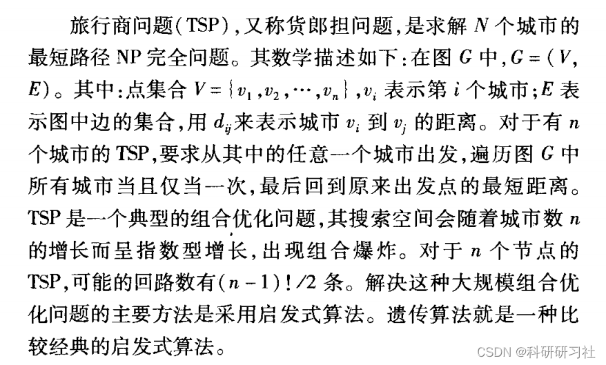
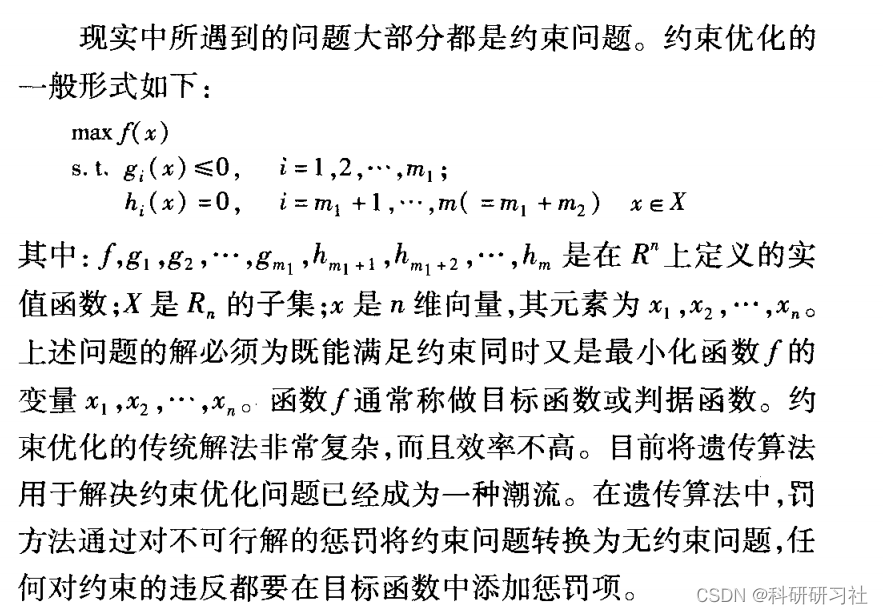
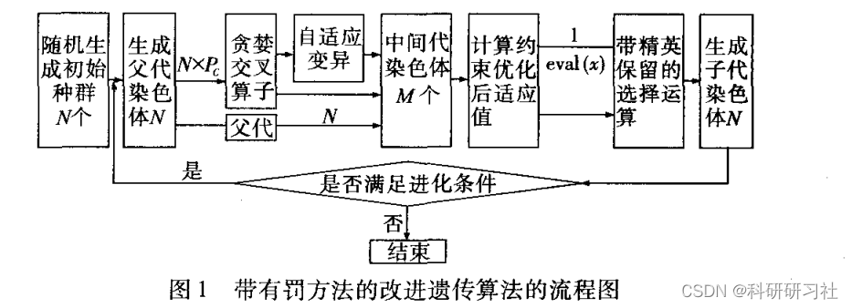
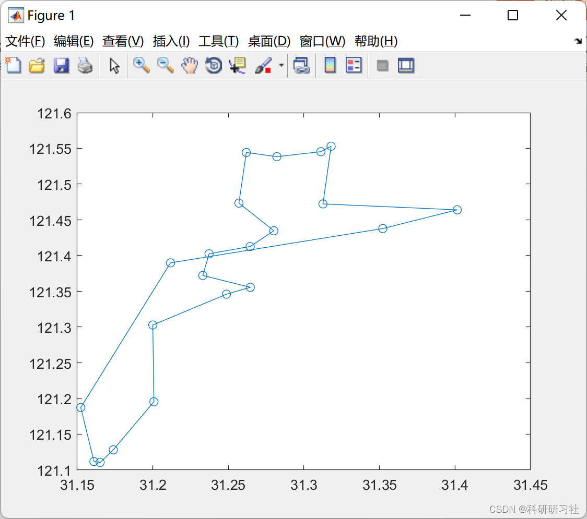
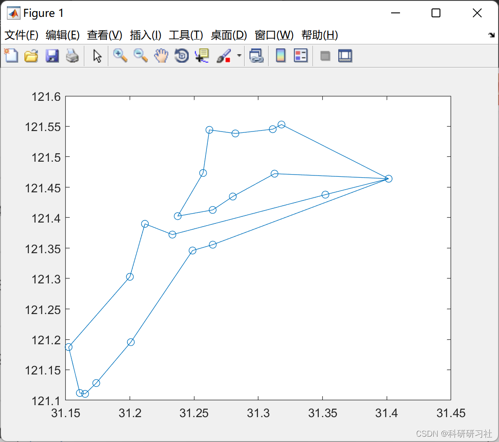

# Genetic Algorithm for TSP Problem (Matlab Code Implementation)

1. Overview of the main research on using genetic algorithms to solve the TSP with constraints. The basic genetic algorithm is improved by combining greedy crossover operator, adaptive mutation operator, and selection operator with elite preservation strategy. The application of penalty method in genetic algorithms for real-world TSP constraints is discussed. An adaptive penalty function is proposed, combined with the improved genetic algorithm, solving the TSP with time constraints. Comparative analysis of experimental results proves the feasibility and effectiveness of this method.
2. Traveling Salesman Problem (TSP)
3. Genetic Algorithms
Genetic algorithms were first proposed by Professor John Holland in 1975. It borrows from the principles of simulation biological genetics and natural selection, enhancing the adaptability of individuals through mechanisms such as natural selection, crossover, and mutation. The genetic operations in the evolutionary process of genetic algorithms are random; however, their characteristics are not entirely random. They can effectively utilize historical information to improve the performance of the next generation population, continuously evolving over generations until they converge to a solution space that is not only close to the optimal solution but also far from it. Genetic algorithms involve five key elements: encoding methods, initial population, fitness function, genetic operators, and control parameters.
Although the basic genetic algorithm has global search capabilities, it often encounters slow convergence or non-convergence during the evolution process, or falls into local optima. Enhancing convergence speed may lead to premature convergence, while too much emphasis may result in missing the optimal solution. Therefore, scholars have conducted extensive research on these aspects, hoping to accelerate convergence speed without causing premature convergence.
4. Constraint Optimization
5. Flowchart of Constraint Optimization with Penalty Method
6. Application of Penalty Function in Genetic Algorithms for TSP
7. Running Results
7.1 Single TSP Problem
7.2 Multi-TSP Problem
8 Matlab Code Implementation
This article only showcases part of the code, all codes and articles can be found in:
TSP problem solved based on genetic algorithm (Matlab code implementation)
% Genetic Algorithm for Single-Tour Problem\n% 20 cities, 1 route\nclear,clc\nclose all\nload city_distance.mat\nload city_location.mat\nCity_Number=20;         % Number of cities\nRace_Number=200;        %Population Size\nIteration=100;          % Iteration count\nP_Cross=0.8;            % Cross-over probability\nP_Mutation=0.2;         % Mutation probability\nrace=zeros(Race_Number,City_Number+2);\n% Initialize the population\nfor i=1:Race_Number                         \n    temp=randperm(City_Number);\n    route=[City_Number+1,temp,City_Number+1];\n    route=ga_hamilton(route);        % Improved Circle Algorithm Optimization for Initial Population\n    race(i,:)=route;\nend\nfor t=1:Iteration\n    adaptation=ga_adaptation(race);         % Calculate fitness size\n    race=ga_choose(race,adaptation);        %Perform selection operation\n    race=ga_cross(race,P_Cross);            %Perform cross operation\n    race=ga_mutation(race,P_Mutation);      %Perform mutation operation\n    [path,val]=ga_plot(race);\n    pause(0.1);\n    fprintf('1.%d is the optimal solution.\n',t,val);\nend\n  
9. References [1] Jiang Tai, Chen Mingjun, Huang Yuan. Genetic Algorithm with Constraint Optimization for TSP Solving [J]. Computer Application Research, 2008, 25(5): 1323-1325

## Images

<!-- PAYMENT_BLOCK -->

## Get this dataset

- Payment link (Stripe): [Buy now](https://buy.stripe.com/3cs8yP7sY87d0vu9AB)
- Payment QR code: 

<!-- /PAYMENT_BLOCK -->
